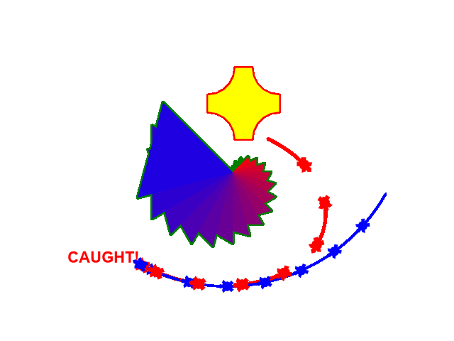
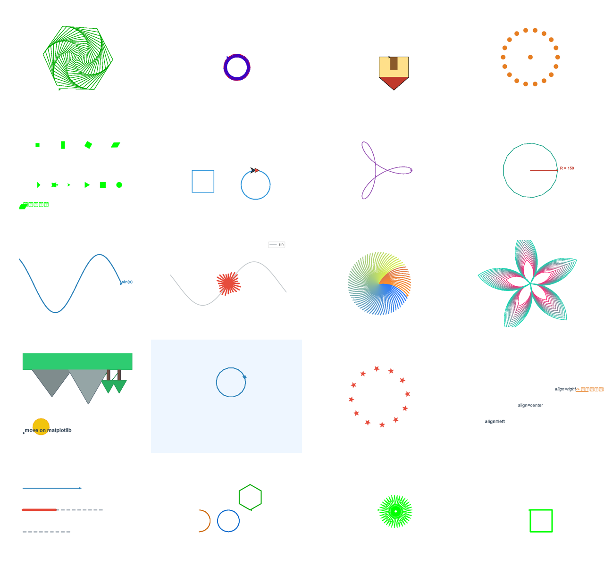

# Move

基于 **matplotlib** 的"海龟绘图"（move graphics）动画模块，由 `turtle.py`（Tkinter 版）改写而来。

```
Move/
├── move.py       主实现：Move / RawMove / MoveScreen / MoveCanvas / Vec2D / Shape ...
├── _painter.py   matplotlib 画布层：折线、填充、文字、图片、事件、重绘调度
├── __init__.py   包导出
├── examples.py   25 个可独立运行的示例（--list 查看）
├── test.py       快速测试（画一组基本图形）
├── demo.py       完整演示（内置演示图形）
├── move.ipynb    notebook 示例
├── _selftest.py  自测套件（17 组）
├── images/       示例预览图（gallery.png 为总览拼图）
├── turtle.py     原 Tkinter 版，保留作对照与参考
└── example.png   运行 demo.py 生成的示例图
```



## 与原 turtle 的对应关系

方法与别名（`fd` / `lt` / `pu` / `seth` …）与 turtle 完全一致，只有类名按模块主题改名：

| turtle                 | move                        |
| ---------------------- | --------------------------- |
| `ScrolledCanvas`       | `MoveCanvas`                |
| `TurtleScreen`         | `MoveScreen` / `MoveScreenBase` |
| `Screen` / `_Screen`   | `MoveScreen`（单例由 `Screen()` 提供） |
| `RawTurtle` / `RawPen` | `RawMove` / `RawPen`        |
| `Turtle` / `Pen`       | `Move` / `Pen`              |
| `Vec2D` / `Shape`      | `Vec2D` / `Shape`（同名）   |

迁移时只需把 `Turtle` 换成 `Move`、`Screen` 换成 `MoveScreen`，
其余代码（包括所有方法名、别名和过程式函数）保持不变。
`move.Turtle` / `move.TurtleScreen` / `move.RawTurtle` / `move.ScrolledCanvas`
也作为兼容别名保留。

## 画布层的变化

| 方面     | turtle（Tkinter）                    | move（matplotlib）                                    |
| -------- | ------------------------------------ | ----------------------------------------------------- |
| 渲染     | `tk.Canvas`                          | `Figure` + `Axes`，1 数据单位 = 1 像素                 |
| 动画     | 每个中间步 `canvas.update()`         | 每个中间步 `canvas.draw()` + `flush_events()`，按 `delay()`/`speed()` 节流 |
| 主循环   | `tkinter.mainloop()`                 | `plt.show()`（`done()` / `mainloop()`）               |
| 事件     | `tag_bind` / `<KeyPress>`            | matplotlib 事件系统（按图元命中测试）                 |
| 外形图片 | `tk.PhotoImage`（GIF）               | Pillow 读位图；无 Pillow 时退化为多边形外形           |
| 滚动条   | `ScrolledCanvas`                     | 用坐标轴范围表示可视区域                              |
| 世界坐标 | 修改 `scrollregion` 并重标定所有图元 | 同样是"画布坐标 + 轴范围"，语义一致                   |

## 公开 API

### 类

```python
Move(shape="classic", undobuffersize=1000, visible=True, fig=None, ax=None)
RawMove(canvas=None, shape="classic", undobuffersize=1000, visible=True)
MoveScreen(cv=None, mode="standard", colormode=1.0, delay=10)
MoveCanvas(fig, ax)
Vec2D(x, y)
Shape(type_, data=None)
```

`Move` 会自动创建 `Figure`/`Axes`；也可以把已有的 `fig`/`ax` 传进来，
与其它 matplotlib 图形画在同一张图上。

### 运动

```python
forward(distance)   fd      back(distance)   backward   bk
right(angle)        rt      left(angle)      lt
goto(x, y)          setpos  setposition     setx(x)   sety(y)
home()              teleport(x=None, y=None, *, fill_gap=False)
pos()               position                   xcor()   ycor()
heading()           setheading(to_angle)       seth
distance(x, y=None)         towards(x, y=None)
degrees(fullcircle=360.0)   radians()
circle(radius, extent=None, steps=None)
```

### 画笔

```python
pendown()  pd  down      penup()  pu  up      isdown()
pensize(width=None)      width            speed(speed=None)
pencolor(*args)          fillcolor(*args) color(*args)
pen(pen=None, **pendict) resizemode(rmode=None)
showturtle()  st         hideturtle()  ht      isvisible()
begin_fill()             end_fill()        filling()
dot(size=None, *color)   stamp()           clearstamp(id)  clearstamps(n=None)
write(arg, move=False, align="left", font=("Arial", 8, "normal"))
begin_poly()  end_poly()  get_poly()
undo()                   undobufferentries()   setundobuffer(size)
clone()
```

### 外形

```python
shape(name=None)                 shapesize(w=None, l=None, outline=None)
turtlesize  # shapesize 的别名
shearfactor(shear=None)          tiltangle(angle=None)      tilt(angle)
shapetransform(t11, t12, t21, t22)          get_shapepoly()
```

### 屏幕

```python
bgcolor(*args)      bgpic(picname=None)     screensize(w=None, h=None, bg=None)
colormode(cmode=None)          tracer(n=None, delay=None)      delay(delay=None)
mode(mode=None)                setworldcoordinates(llx, lly, urx, ury)
register_shape(name, shape=None)   addshape      getshapes()
turtles()           window_width()     window_height()
getcanvas()         getfigure()        getaxes()
clear()  clearscreen      reset()  resetscreen
update()            mainloop()  done()
bye()               exitonclick()
onclick(fun, btn=1, add=None)      onscreenclick
onkey(fun, key)     onkeypress(fun, key=None)   onkeyrelease
listen()            ontimer(fun, t=0)
textinput(title, prompt)           numinput(title, prompt, default=None, minval=None, maxval=None)
title(titlestring)  setup(width, height, startx=None, starty=None)
```

### 便捷函数（move 特有）

```python
get_screen()      # 取（必要时创建）MoveScreen 单例
get_figure()      # 取当前 Figure
get_axes()        # 取当前 Axes
savefig(path)     # update() 后保存图片
reset_screen()    # 丢弃单例，下次绘图重新开窗
```

## 示例

`examples.py` 里有 25 个可独立运行的例子，覆盖从入门到综合的用法：

```bash
python cprdspy/CPR_matplotlib/Move/examples.py --list          # 列出全部
python cprdspy/CPR_matplotlib/Move/examples.py square          # 跑一个
python cprdspy/CPR_matplotlib/Move/examples.py square star     # 跑多个
python cprdspy/CPR_matplotlib/Move/examples.py all             # 依次跑全部
MPLBACKEND=Agg python cprdspy/CPR_matplotlib/Move/examples.py all --save out/   # 批量出图
```

在 Jupyter / 自己的脚本里也可以直接调用：

```python
from cprdspy.CPR_matplotlib.Move import examples

examples.spiral()
examples.scene()
```



| 例子 | 演示的能力 |
| --- | --- |
| `square` | 最小的完整程序：forward / left |
| `star` | 循环 + 转角（五角星） |
| `spiral` | 递增步长的螺旋 |
| `rainbow_flower` | `colormode(255)` + 逐段改色做渐变 |
| `animated_polygon` | 同一段代码在 `speed(1)` 与 `speed(0)` 下的差别 |
| `hypno_spiral` | 经典的 36 步海龟图形 |
| `circle_walk` | `circle()` 的整圆 / 圆弧 / 正多边形三种用法 |
| `filled_house` | `begin_fill` / `end_fill` 填充多个面 |
| `stamped_ring` | `stamp()` 沿圆周盖章 |
| `poly_star_shape` | `begin_poly` / `get_poly` / `register_shape` 自定义外形 |
| `labels` | `write()` 的三种对齐、字体、`move=True` |
| `shapes_gallery` | 内置外形一览 + `shapesize` / `tilt` / `shearfactor` |
| `compound_turtle` | `Shape("compound")` 多色外形 |
| `spirograph` | 用绝对坐标画内摆线（数学曲线） |
| `math_star` | `Vec2D` / `distance()` / `towards()` 做几何计算 |
| `world_plot` | `setworldcoordinates()` 下直接画 sin 曲线 |
| `with_matplotlib` | 与普通 matplotlib 图形共用同一对 `fig`/`ax` |
| `keyboard_drive` | 键盘事件（方向键移动，Esc 退出） |
| `click_to_move` | 屏幕级 `onclick`：点哪走哪 |
| `timer_animation` | `ontimer` 自驱动动画（不阻塞脚本） |
| `undo_demo` | `undo()` 逐格撤回（跑完画面是空的，看的是过程） |
| `pen_state` | `pen()` 保存/恢复画笔状态 + `dot()` 画点 |
| `mandala` | 渐变 + 高度对称的放射线 |
| `rose` | 用 `circle()` 拼出的数学玫瑰 |
| `scene` | 综合：太阳/山/树/草地的填充风景 |

预览图在 [`images/`](images) 下（`gallery.png` 是总览拼图）。

### 几个最小片段

**最简（过程式，和 turtle 一模一样）**

```python
from cprdspy.CPR_matplotlib.Move.move import *

speed(0)
for i in range(60):
    forward(i * 2)
    left(59)
done()
```

**填充 + 颜色**

```python
from cprdspy.CPR_matplotlib.Move.move import *

color("#2c3e50", "#f1c40f")
begin_fill()
for _ in range(4):
    forward(120)
    left(90)
end_fill()
done()
```

**记录一个形状并注册成外形**

```python
from cprdspy.CPR_matplotlib.Move.move import *

begin_poly()
for _ in range(5):
    forward(40)
    left(144)
end_poly()
screen = getscreen()
screen.register_shape("mystar", get_poly())

shape("mystar")
for i in range(12):
    penup()
    goto(0, 0)
    setheading(i * 30)
    forward(150)
    stamp()
done()
```

**在无窗口环境批量出图**

```python
import matplotlib
matplotlib.use("Agg")  # 必须在 pyplot 之前

from cprdspy.CPR_matplotlib.Move.move import *

for turn in (60, 90, 120, 144):
    reset_screen()
    speed(0)
    for _ in range(360 // turn):
        forward(150)
        left(turn)
    savefig("poly_%d.png" % turn)
```

## 用法

### 0. 从 CPR_matplotlib 包使用（推荐，统一 `move_` 前缀）

本模块的全部公开名字都以 `move_` 前缀导出到了 `cprdspy.CPR_matplotlib`，
因此可以和圆形、弧线、花朵等其它子模块一起导入而不会撞名：

```python
import cprdspy.CPR_matplotlib as cpm

t = cpm.move_Move()          # 等价于 Move()
t.speed(0)
t.forward(100)
t.left(90)
t.circle(50)

cpm.move_bgcolor("lightyellow")
cpm.move_speed(6)
cpm.move_forward(60)
```

过程式接口同样带了前缀（`move_forward` / `move_fd` / `move_left` / `move_done` …），
它们共用同一个默认屏幕：

```python
from cprdspy.CPR_matplotlib import move_speed, move_fd, move_lt, move_done

move_speed(0)
for _ in range(4):
    move_fd(100)
    move_lt(90)
move_done()
```

类也一并导出：`move_Move`、`move_RawMove`、`move_MoveScreen`、`move_MoveScreenBase`、
`move_MoveCanvas`、`move_Pen`、`move_RawPen`、`move_Shape`、`move_Vec2D`。

### 1. 面向对象（从 move 模块导入）

```python
import matplotlib.pyplot as plt
from cprdspy.CPR_matplotlib.Move.move import Move

m = Move()
m.speed(0)
for _ in range(36):
    m.forward(120)
    m.left(170)
plt.show()
```

### 2. 过程式（与 turtle 完全一致）

```python
from cprdspy.CPR_matplotlib.Move.move import *

speed(6)
for _ in range(4):
    forward(100)
    left(90)
done()
```

### 3. 与现有 matplotlib 图形组合

```python
import matplotlib.pyplot as plt
from cprdspy.CPR_matplotlib.Move.move import Move

fig, ax = plt.subplots()
ax.plot([0, 1, 2], [0, 1, 4], color="orange")   # 普通 matplotlib 图形

m = Move(fig=fig, ax=ax)
m.speed(0)
m.pencolor("blue")
for _ in range(5):
    m.forward(60)
    m.left(144)

plt.show()
```

### 4. 无界面环境（生成图片）

```python
import matplotlib
matplotlib.use("Agg")           # 必须在 pyplot 之前

from cprdspy.CPR_matplotlib.Move.move import Move, savefig

m = Move()
m.speed(0)
m.circle(80)
savefig("move.png")             # 内部先 update() 再保存
```

## 动画与速度

* `speed(n)`：`0` 表示不做动画（瞬间到位，绘制内容完全一样）；`1..10` 越大越快；
  也接受 `"fastest" / "fast" / "normal" / "slow" / "slowest"`。
  动画通过在起点与终点之间插入中间步实现，**每一步都会真正刷屏一次**
  （`canvas.draw()` + `window.update()`），所以能看到小海龟一步步走。
* `delay(ms)`：两帧之间的基准时间（默认 10）。
  实际帧间隔 = `9ms × 1.2^(10-2×speed) × (delay/10)`，
  即 speed=1 约 39ms/帧、speed=10 约 1.5ms/帧 —— 几何级数，
  所以相邻档位的时间差是等比例的，肉眼分得出来。
* 每个 `forward`/`left` 的插值步数上限随 speed 递减（speed=1 约 5 步，
  speed≥3 约 3 步），因此"speed 越大越快"在总时长上确实成立，
  同时保证任何 `speed>0` 都至少有一次中间帧（否则就不叫动画了）。
* `tracer(n, delay)`：只每隔 `n` 次更新才真正绘制一次；`tracer(0)` 完全关闭自动重绘，
  之后需要手工 `update()`。这三个是 turtle 的语义，与上面不冲突。

`move` 相对 turtle 的三点便利改进：

* `speed` 属于"画得多细"的设置，**不会被 `reset()` 重置**。
  turtle 里 `speed(0); reset()` 会把速度恢复成默认的 3，动画会莫名其妙地"复活"。
* `delay()` 在海龟对象上也能直接调用（`t.delay(20)`），等价于 `getscreen().delay(20)`。
* 录制 / 批量出图时可以关掉等待：`t.getscreen().painter.interactive = False`。

**不同后端下"能不能看到动画"**：

| 运行方式 | 后端 | 表现 |
| --- | --- | --- |
| `python x.py`（有桌面环境） | TkAgg / QtAgg | 逐帧动画，肉眼可见 ✅ |
| Jupyter，`%matplotlib inline` | inline | 只有最后一帧；中间帧已画但被合并 |
| Jupyter，`%matplotlib widget` | ipympl | 逐帧动画（需装 `ipympl`） |
| 服务器 / `MPLBACKEND=Agg` | Agg | 不阻塞、不显示，但每帧都真的画过（可 `savefig`） |

也就是说：**在 Jupyter 默认的 inline 后端里看不到动画是 matplotlib 的限制**，
不是模块没有插值。要在 notebook 里看动画请用 `%matplotlib widget`，
或把代码存成 `.py` 用 `python` 运行。

小提示：`speed(1)` 最慢，适合演示；日常画图用默认 `speed(3)` 就行；
批量生成图片时用 `speed(0)`，速度最快且画面完全一致。

## 交互说明

matplotlib 的事件系统与 Tk 略有差异，本模块做了以下适配：

* `onkey(fun, key)` 绑定**按键释放**，`onkeypress(fun, key)` 绑定**按键按下**，与 turtle 一致；
* 按键名统一归一化：`"Up"`、`"up"`、`"UP"` 等价，`"space"` 与 `" "` 等价；
* `onkeypress(fun)`（不给 key）匹配任意按键；
* `onclick` / `ondrag` / `onrelease` 绑定在具体的 move 外形上，
  点击/拖动时按"外形命中测试"分发；屏幕级 `onclick` 始终触发（先外形，后屏幕）；
* 键盘事件需要图形窗口获得焦点，先调用 `listen()`；
* `textinput` / `numinput` 优先使用轻量 Tk 对话框，Tk 不可用时退回命令行输入。

## 配置文件

支持 turtle 的配置机制：在当前工作目录或本模块目录放 `move.cfg`
（同时兼容 `turtle.cfg`），可覆盖默认配置：

```
width = 0.5            # 窗口宽度（浮点数=屏占比，整数=像素）
height = 0.75
canvwidth = 800        # 画布宽（像素）
canvheight = 600
mode = standard
colormode = 1.0
delay = 10
undobuffersize = 1000
shape = classic
pencolor = #0f0
fillcolor = #0f0
resizemode = noresize
visible = True
title = Python Move Graphics
figsize = None         # (宽, 高) 英寸；None 表示按画布像素和 dpi 推算
dpi = 100
```

也支持 `importconfig = myway`：会去读同目录下的 `move_myway.cfg`。

## 默认外观与数值精度

* **默认颜色是 `#0f0`**（`pencolor` 与 `fillcolor`）。turtle 默认是黑色，
  在浅色画布上不够醒目；`#0f0` 是纯绿，和本仓库其它绘图模块的默认色一致。
  想要 turtle 的观感就 `pencolor("black")`，或写进 `move.cfg`。
* **角度不再被固定截断**。turtle 用 `round(..., 10)` 处理 `heading()`/`towards()`，
  在某些 `degrees()` 设置下会丢精度；move 改成"只在极接近整数时吸附"，
  所以 `degrees(400); left(100)` → `heading() == 100.0`，
  而 `left(33.333333333333)` 也完整保留到小数点后 13 位。
* **`Vec2D` 的 `repr` 不再截断成 2 位小数**（turtle 是 `(%.2f,%.2f)`，
  `Vec2D(1/3, 2/7)` 会显示成 `(0.33,0.29)`）。现在用最短往返表示。
* 颜色往返转换（hex → RGB → 显示）吸附掉 1e-16 级浮点噪声，
  `pencolor()` 读回的是干净的整数值。

## 与 turtle 的已知差异

1. **类名**：`Turtle`→`Move`、`Screen`→`MoveScreen`（兼容别名已提供）。
2. **滚动条**：matplotlib 没有 Tk 那样的滚动条画布，可视区域改用坐标轴范围表达；
   `screensize()` 会同时调整画布与坐标轴范围。
3. **`reset()` 保留 `speed`**：turtle 会把 speed 恢复成默认 3，
   导致 `speed(0); reset()` 之后动画"复活"；move 里 speed 只表示画得多细，
   不属于被清理的绘图状态。（`delay()`/`tracer()` 本来就属于屏幕，不受影响。）
4. **动画步数有上限**：matplotlib 每帧要重绘整张图，所以慢速 + 长距离的
   插值步数按 speed 设了上限（否则 36 步的经典图形会被拖到几十秒）。
   turtle 里 `speed(1)` 一条长线可以慢慢爬很久，move 会在有限步内走完，
   但每一步都真的显示出来。
5. **图片外形**：turtle 用 Tk 的 `PhotoImage`（只能 GIF），
   move 用 Pillow 读位图；未安装 Pillow 时 `register_shape("x.png")` 会抛出 `TurtleGraphicsError`。
6. **`bye()`**：只关闭由本模块创建的图形窗口；用外部 `fig`/`ax` 创建的屏幕不会关掉用户的图。
7. **`_Screen` 单例**：过程式接口共用一个默认屏幕；
   用 `Move(fig=..., ax=...)` 或 `MoveScreen(...)` 显式指定的屏幕彼此独立。
8. **`t.delay()`**：move 额外在海龟对象上提供了 `delay()`（turtle 只有屏幕层有）。

## 自测

```bash
python cprdspy/CPR_matplotlib/Move/_selftest.py
```

覆盖向量运算、过程式 API、折线/填充/印章/文字/点、撤销、世界坐标、
tracer/speed/delay、动画刷帧与节流、多对象与 clone、事件分发、
外部 fig/ax 共存、角度精度、默认颜色、异常路径与图片外形
（默认使用 Agg 后端，无窗口）。
