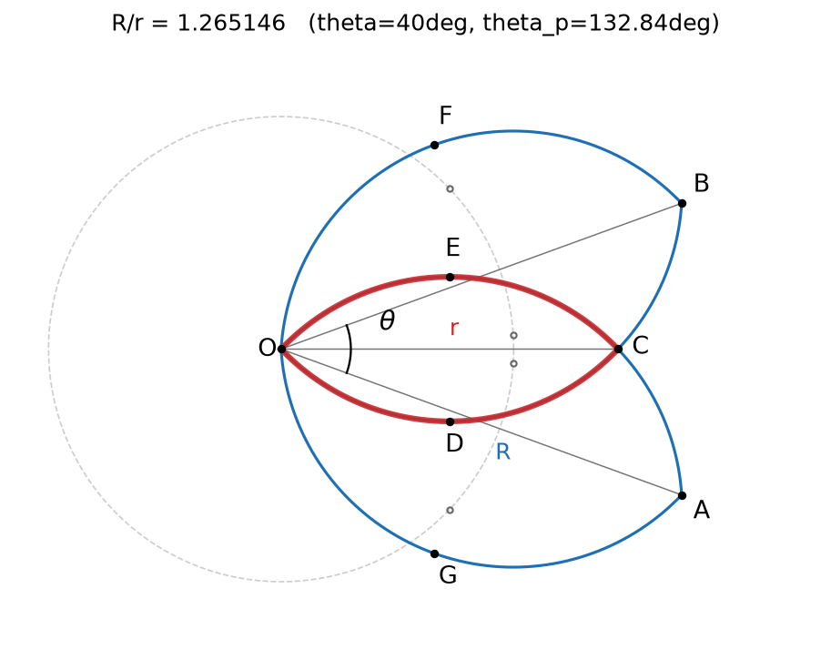
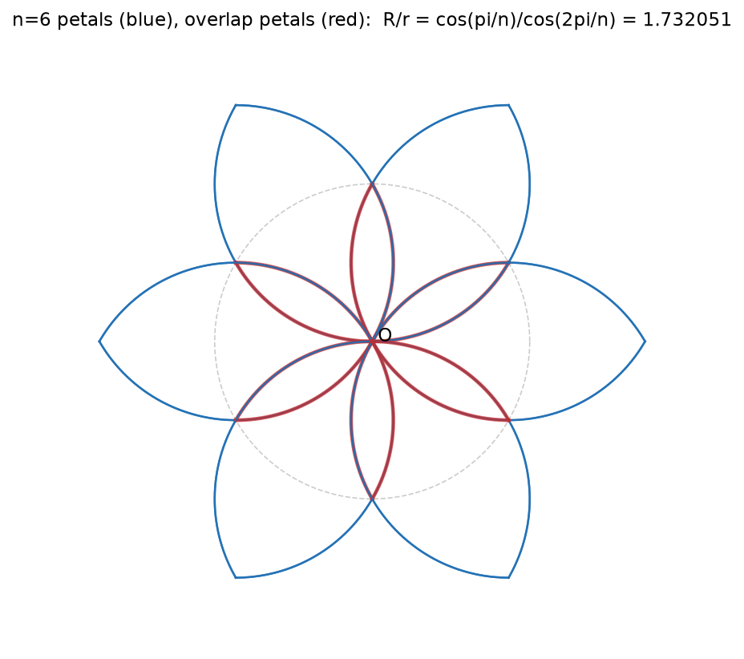
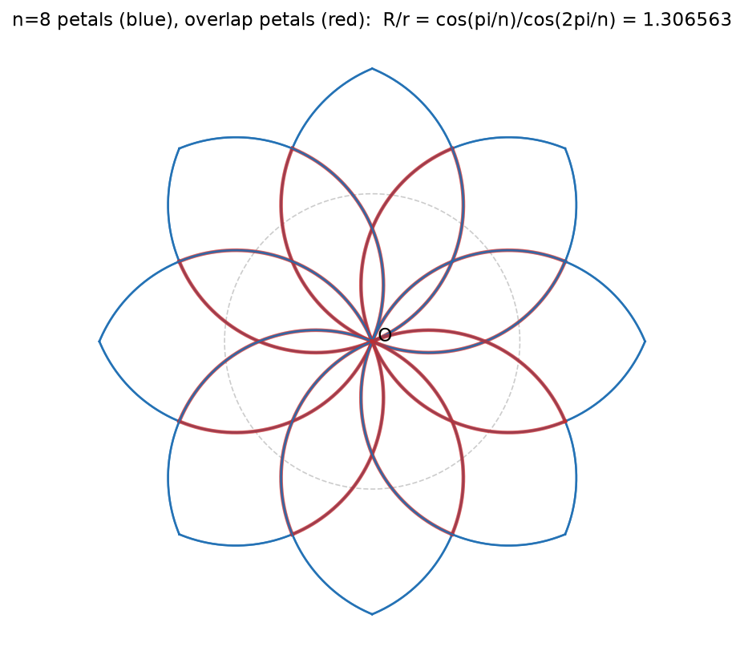

# 大小花瓣长度比 R/r —— 对称弧花瓣相交的闭合解

**问题（对应你的手绘图）**：两片由对称弧组成的全等花瓣共基点 $O$，尖端分别为 $A$、$B$，轴夹角 $\angle AOB=\theta$。
两瓣相交形成一个以小花瓣尖 $C$ 为另一顶点的**小花瓣** $ODCE$。求

$$\frac{R}{r}=\frac{|OA|}{|OC|}\quad(\text{大花瓣长 / 小花瓣长})$$

---

## 0. 结论速览

| 情形 | 公式 |
|------|------|
| **最一般**（任意瓣形、任意 $\theta$） | $\displaystyle \frac{R}{r}=\frac{R}{R\cos\frac{\theta}{2}-d_c\sin\frac{\theta}{2}}$ |
| 用**花瓣张角** $\theta_p$ 表述 | $\displaystyle \frac{R}{r}=\frac{\sin\frac{\theta_p}{2}}{\sin\frac{\theta_p-\theta}{2}}$ |
| 用**对称弧最大距离（拱宽）** $d$ 表述 | $\displaystyle \frac{R}{r}=\frac{2Rd}{2Rd\cos\frac{\theta}{2}-(R^{2}-d^{2})\sin\frac{\theta}{2}}$ |
| **cprdspy 的 n 花瓣**（默认 `R=r`，弧半径=中心圆半径） | $\displaystyle \frac{R}{r}=\frac{\cos\frac{\pi}{n}}{\cos\!\left(\frac{\pi}{n}+\frac{\theta}{2}\right)}$ |
| n 花瓣的**相邻两瓣**（$\theta=\frac{2\pi}{n}$） | $\displaystyle \frac{R}{r}=\frac{\cos\frac{\pi}{n}}{\cos\frac{2\pi}{n}}=\frac{\cos\frac{\theta}{2}}{\cos\theta}$ |

其中 $d_c$ 是**两弧圆心距**，$R=2a$ 是大花瓣长。最后一行是只含 $\theta$ 的干净结果，也就是你纸上写的 $\dfrac{R}{r}=?$ 的答案。

存在条件：$\theta<\theta_p$（两瓣真重叠）；$\theta\to\theta_p$ 时 $r\to0$，$R/r\to\infty$。

---

## 1. 记号与模型

一片"对称弧花瓣"= 两个等半径圆的交（lens）：

```
弧半径      rho        （两圆半径）
圆心距      d_c        （两圆心 |C_1C_2|，关于花瓣轴对称）
半瓣长      a = sqrt(rho^2 - d_c^2/4)
瓣长        R = 2a                        ← 图中的 |OA|
张角        theta_p = 2*arctan(R/d_c)     ← 花瓣在根部 O 处的开口角
拱宽        d = 2*rho - d_c               ← "对称弧最大距离"
```

三者的互化（后面会用到）：

$$R^{2}=d^{2}+2d\,d_c\ \Longrightarrow\ d_c=\frac{R^{2}-d^{2}}{2d},\qquad d=R\tan\frac{\theta_p}{4},\qquad \tan\frac{\theta_p}{2}=\frac{R}{d_c}$$

两圆都过根部 $O$（因为 $|(a,\pm d_c/2)|=\sqrt{a^2+d_c^2/4}=\rho$），这正是图中"所有弧都从 $O$ 出发"，也正是项目里 `flower_petal(R, r, n)` 取 $r=R$（弧半径 = 中心圆半径）时花瓣从花心发散的情形。

**内弧 / 外弧的判定**（关键，容易搞反）：lens 的边界弧永远属于**另一半侧的圆心**——上边界弧由位于轴**下方**的圆生成。所以

* 花瓣 1（轴在 $-\theta/2$）的**内侧**弧 = 圆心 $C_1=\mathrm{Rot}(-\tfrac{\theta}{2})(a,\,-\tfrac{d_c}{2})$ 的圆；
* 花瓣 2（轴在 $+\theta/2$）的**内侧**弧 = 圆心 $C_2=\mathrm{Rot}(+\tfrac{\theta}{2})(a,\,+\tfrac{d_c}{2})$ 的圆。



---

## 2. 定理与证明

> **定理** 设两全等对称弧花瓣共基点 $O$，轴夹角 $\theta$，且 $\theta<\theta_p$。则小花瓣长
> $$\boxed{\,r=R\cos\frac{\theta}{2}-d_c\sin\frac{\theta}{2}\,}$$
> 从而 $\;R/r=\dfrac{1}{\cos\frac{\theta}{2}-\frac{d_c}{R}\sin\frac{\theta}{2}}=\dfrac{\sin\frac{\theta_p}{2}}{\sin\frac{\theta_p-\theta}{2}}$。

**证明。**

取角平分线为 $x$ 轴，$O$ 为原点。记 $\gamma=\theta/2$。

**（1）两个内侧圆心。** 由 §1，
$$C_1=\mathrm{Rot}(-\gamma)\big(a,\,-\tfrac{d_c}{2}\big),\qquad C_2=\mathrm{Rot}(+\gamma)\big(a,\,+\tfrac{d_c}{2}\big)$$
展开（$\mathrm{Rot}(\phi)(x,y)=(x\cos\phi-y\sin\phi,\;x\sin\phi+y\cos\phi)$）：

$$C_1=\Big(a\cos\gamma-\tfrac{d_c}{2}\sin\gamma,\;\;-\big(a\sin\gamma+\tfrac{d_c}{2}\cos\gamma\big)\Big)$$
$$C_2=\Big(a\cos\gamma-\tfrac{d_c}{2}\sin\gamma,\;\;+\big(a\sin\gamma+\tfrac{d_c}{2}\cos\gamma\big)\Big)$$

**（2）两圆等半径且横坐标相同。** 记
$$x_0=a\cos\gamma-\tfrac{d_c}{2}\sin\gamma,\qquad m=a\sin\gamma+\tfrac{d_c}{2}\cos\gamma$$
则 $C_1=(x_0,-m)$、$C_2=(x_0,+m)$，连线 $C_1C_2$ 竖直。两等圆根轴 $\perp C_1C_2$，故根轴是**水平线**；又 $|C_1|=|C_2|=\rho$（直接验证 $x_0^2+m^2=a^2+d_c^2/4=\rho^2$），所以 $O\in$ 根轴，根轴即 $x$ 轴。**两内圆的交点都在 $x$ 轴上**，即小花瓣的尖端 $C$ 落在角平分线上（与图一致）。

**（3）求第二个交点。** 圆 $C_1$ 与 $x$ 轴的交点满足 $(x-x_0)^2+m^2=\rho^2=x_0^2+m^2$，得 $x=0$ 或 $x=2x_0$。$x=0$ 是 $O$，故
$$C=(2x_0,0),\qquad r=|OC|=2x_0=2a\cos\gamma-d_c\sin\gamma=R\cos\frac{\theta}{2}-d_c\sin\frac{\theta}{2}\qquad\blacksquare$$

**（4）换成张角。** 用 $\tan\frac{\theta_p}{2}=\frac{R}{d_c}$，即 $\frac{d_c}{R}=\cot\frac{\theta_p}{2}$：

$$\frac{r}{R}=\cos\frac{\theta}{2}-\cot\frac{\theta_p}{2}\sin\frac{\theta}{2}
=\frac{\sin\frac{\theta_p}{2}\cos\frac{\theta}{2}-\cos\frac{\theta_p}{2}\sin\frac{\theta}{2}}{\sin\frac{\theta_p}{2}}
=\frac{\sin\frac{\theta_p-\theta}{2}}{\sin\frac{\theta_p}{2}}$$

**（5）换成拱宽 $d$。** 用 $\dfrac{d_c}{R}=\dfrac{R^2-d^2}{2Rd}$ 代入即得 §0 表中第三式。

---

## 3. 推论：张角定理（更好看的形式）

小花瓣本身也是一片 lens：它的两圆心是 $C_1,C_2$，圆心距

$$d_c'=\lvert C_1C_2\rvert=2m=R\sin\frac{\theta}{2}+d_c\cos\frac{\theta}{2}$$

于是它的张角 $\theta_s$ 满足 $\tan\frac{\theta_s}{2}=\dfrac{r}{d_c'}$：

$$\tan\frac{\theta_s}{2}=\frac{R\cos\frac{\theta}{2}-d_c\sin\frac{\theta}{2}}{R\sin\frac{\theta}{2}+d_c\cos\frac{\theta}{2}}
=\frac{\tan\frac{\theta_p}{2}-\tan\frac{\theta}{2}}{1+\tan\frac{\theta_p}{2}\tan\frac{\theta}{2}}
=\tan\frac{\theta_p-\theta}{2}$$

> **张角定理** $\theta_s=\theta_p-\theta$：小花瓣的张角 = 大花瓣张角 − 两瓣轴夹角。
> 因此长度比就是**半张角正弦之比**：$\displaystyle\frac{R}{r}=\frac{\sin(\theta_p/2)}{\sin(\theta_s/2)}$。

**递推（第 $k$ 个邻居）。** 轴夹角 $k\theta$ 的两瓣，其重叠瓣

$$r_k=R\cos\frac{k\theta}{2}-d_c\sin\frac{k\theta}{2},\qquad \theta_s^{(k)}=\theta_p-k\theta$$

张角构成等差数列，比值望远镜相消：$\dfrac{R}{r_k}=\dfrac{\sin(\theta_p/2)}{\sin((\theta_p-k\theta)/2)}$。

**注意**：小花瓣与大花瓣**不可能相似**（$\theta_s=\theta_p$ 要求 $\theta=0$）。

---

## 4. 特例：cprdspy 的 n 花瓣

项目默认 `flower_petal(R=1, r=1, n)` 即 **弧半径 = 中心圆半径** $\rho=R_c$，此时

$$d_c=2R_c\sin\frac{\pi}{n},\qquad R=2a=2R_c\cos\frac{\pi}{n},\qquad \theta_p=\pi-\frac{2\pi}{n}$$

代入定理：

$$r=2R_c\Big[\cos\frac{\pi}{n}\cos\frac{\theta}{2}-\sin\frac{\pi}{n}\sin\frac{\theta}{2}\Big]=2R_c\cos\Big(\frac{\pi}{n}+\frac{\theta}{2}\Big)$$

$$\boxed{\;\frac{R}{r}=\frac{\cos\frac{\pi}{n}}{\cos\!\left(\frac{\pi}{n}+\frac{\theta}{2}\right)}=\frac{\cos\frac{\pi}{n}}{\sin\frac{\theta_s}{2}}\;}$$

**相邻花瓣** $\theta=\frac{2\pi}{n}$（$\pi/n=\theta/2$）：

$$\frac{R}{r}=\frac{\cos\frac{\pi}{n}}{\cos\frac{2\pi}{n}}=\frac{\cos\frac{\theta}{2}}{\cos\theta}$$

| $n$ | $\theta=2\pi/n$ | $\theta_p=\pi-2\pi/n$ | $R$（$R_c=1$） | $r$ | $R/r$ | 闭式 |
|----:|----------------:|---------------------:|---------------:|----:|------:|------|
| 3 | 120° | 60° | 1.000000 | — | 不存在 | $\theta>\theta_p$，两瓣分离 |
| 4 | 90° | 90° | 1.414214 | 0 | $\to\infty$ | 相切于 $O$，无重叠 |
| 5 | 72° | 108° | 1.618034 | 0.618034 | **2.618034** | $\varphi^{2}$（黄金比平方） |
| 6 | 60° | 120° | 1.732051 | 1.000000 | **1.732051** | $\sqrt{3}$ |
| 7 | 51.43° | 128.57° | 1.801938 | 1.246980 | 1.445042 | — |
| 8 | 45° | 135° | 1.847759 | 1.414214 | **1.306563** | $\sqrt{1+\sqrt2}$ |
| 9 | 40° | 140° | 1.879385 | 1.532089 | 1.226682 | — |
| 10 | 36° | 144° | 1.902113 | 1.618034 | 1.175571 | — |
| 12 | 30° | 150° | 1.931852 | 1.732051 | 1.115355 | — |

两个漂亮的巧合：$n=5$ 给出 $\varphi^2$（$R=\varphi$，$r=1/\varphi$）；$n=6$ 时 $r=R_c=1$，小花瓣尖 $C$ 恰好落在中心圆上（就是相邻两瓣共用的那个弧心）。






---

## 5. 存在性与退化

| 条件 | 几何 | $R/r$ |
|------|------|------|
| $\theta<\theta_p$ | 两瓣重叠，小花瓣存在 | 有限，随 $\theta$ 单调增 |
| $\theta=\theta_p$ | 两内圆外切于 $O$，$C=O$ | $\infty$ |
| $\theta>\theta_p$ | 两瓣只共 $O$，无重叠 | 无定义（解析式给负值，即交点跑到 $O$ 背后） |

对 n 花瓣的相邻情形，$\theta<\theta_p\iff\frac{2\pi}{n}<\pi-\frac{2\pi}{n}\iff n>4$。
**所以只有 5 瓣及以上的花，相邻花瓣才会相交出小花瓣**——这与项目里"当 $n<N$ 时花瓣有重叠"的经验一致。

---

## 6. 与 docs 中已有证明的对应

| 已有文档 | 符号 | 本文对应 |
|----------|------|----------|
| `docs/一般对称中心花的数学及算法.md` | $r^{2}=a^{2}+d^{2}$，$\theta=2\arctan\frac{a}{d}$，$BD=2d$ | 该文档 $r=\rho$（弧半径）、$d=\frac{d_c}{2}$（弧心纵偏移）、$a$ = 半瓣长、$\theta$ = 弧跨度 = 本文 $\theta_p$、$BD=d_c$ = 圆心距 |
| `cprdspy/CPR_matplotlib/Flowers/flower.py`、`flower_math.md` | $a=R\sin\frac{\pi}{n}$，$\beta=\arccos\frac{a}{r}$，$\theta_{\text{arc}}=\frac{\pi}{2}-\frac{\pi}{n}+\beta$ | $a_{\text{doc}}=\frac{d_c}{2}$；$\theta_{\text{arc}}=\theta_p$。取 $r=R=R_c$ 时 $\theta_p=\pi-\frac{2\pi}{n}$ ✓ |
| `docs/知乎发表/曼陀罗花的数学几何及算法.md` | $L=2b$，$L_c=R\cos\frac{\pi}{n}+b$，$L_s=R\cos\frac{\pi}{n}-b$ | $\rho=R_c$ 时 $b=R_c\cos\frac{\pi}{n}$，$L_s=0$（根部就在花心 $O$），$L=2b=R$ ✓ |

也就是说：本文的"花瓣都过 $O$"= 曼陀罗花文档里 $L_s=0$ 的临界情形，也正是 `flower_petal` 默认参数 $R=r$ 的情形。

---

## 7. 数值验证

脚本：[`examples/petal_ratio_R_r.py`](../../examples/petal_ratio_R_r.py)（`python examples/petal_ratio_R_r.py --save` 同时重生成配图）

1. **交点 vs 公式**：$\rho\in\{0.7,1.0,1.3\}\times d_c\in\{0.4,0.9,1.5,1.9\}\times\theta\in\{10°,25°,40°,60°\}$ 共 40 组有效参数，直接解两内圆交点得到 $r$，与 $R\cos\frac{\theta}{2}-d_c\sin\frac{\theta}{2}$ 比较，**最大绝对误差 $4.4\times10^{-16}$**（机器精度）。
2. **三种写法互检**：圆心距式 / 张角式 / 拱宽式 三者一致，误差 $\le 3.3\times10^{-16}$。
3. **张角定理**：5 组参数下 $\theta_s-(\theta_p-\theta)$ 误差 $\le 2.2\times10^{-16}$；第 $k$ 邻居张角确实等差递减（$\theta_p=120°,\theta=20°$ 时 $k=1,2,3$ 得 $100°,80°,60°$）。
4. **n 花瓣闭式**：$n=5,6,7,8,9,10,12$ 全部与 $\cos\frac{\pi}{n}\big/\cos\frac{2\pi}{n}$ 吻合到 $10^{-16}$；$\theta$ 任意时与 $\cos\frac{\pi}{n}\big/\cos(\frac{\pi}{n}+\frac{\theta}{2})$ 吻合。
5. **"小花瓣 = 两花瓣真实交集"**：$1200\times1200$ 网格积分，7 组参数的对称差面积 $=0$（在网格分辨率下严格相等），确认小花瓣就是交集区域，而不是它的近似。

---

## 8. 一句话总结

> 大花瓣与小花瓣的长度比只由**两个角**决定：
> $$\frac{R}{r}=\frac{\sin(\theta_p/2)}{\sin(\theta_s/2)},\qquad \theta_s=\theta_p-\theta$$
> 相交瓣把花瓣的张角**恰好减去夹角 $\theta$**，长度按半张角正弦同比缩小。
> 对项目默认的 n 花瓣相邻两瓣，这就是 $\dfrac{R}{r}=\dfrac{\cos(\theta/2)}{\cos\theta}$，$\theta=\dfrac{2\pi}{n}$。
