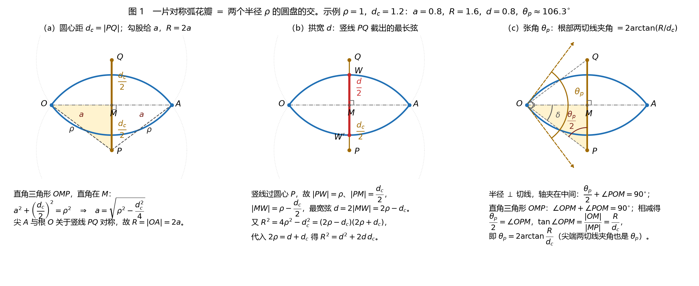
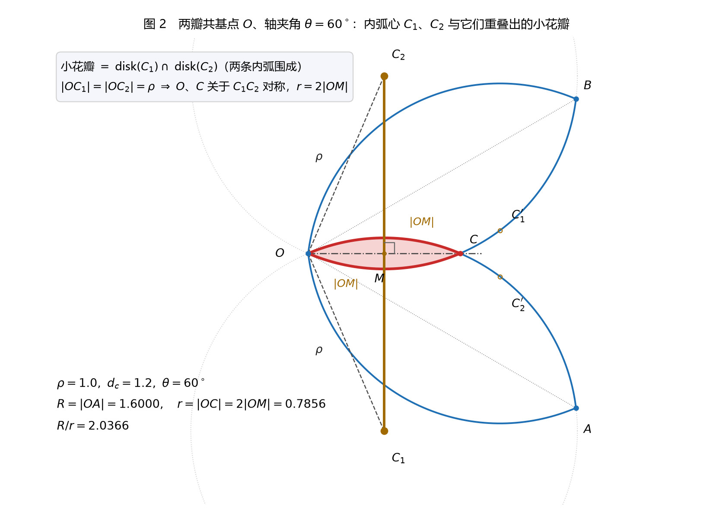
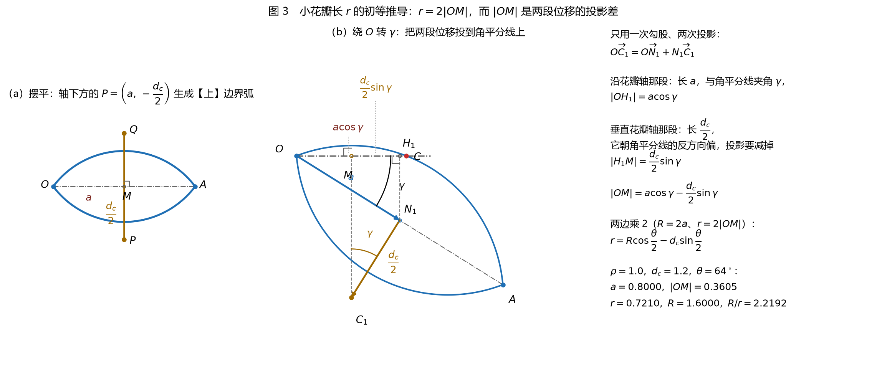
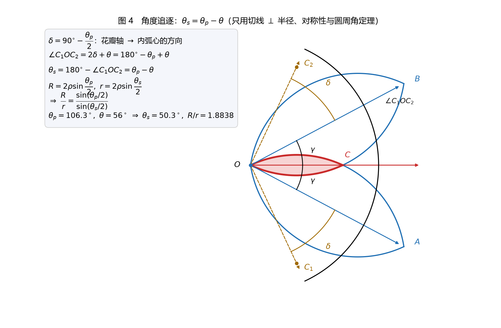
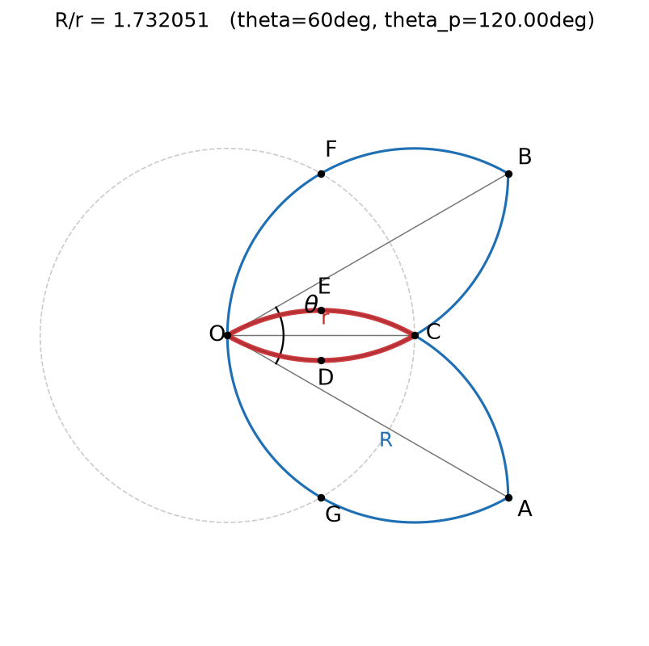

# 大小花瓣长度比 R/r —— 只用初等几何的证明

**问题**：两片全等的"对称弧花瓣"共基点 $O$，尖端分别是 $A$、$B$，两轴夹角 $\angle AOB=\theta$。
两瓣重叠出一个以 $C$ 为尖端的**小花瓣**。求

$$\frac{R}{r}=\frac{|OA|}{|OC|}\qquad(\text{大花瓣长}\,/\,\text{小花瓣长})$$

---

## 先把几个问题一句一句答清楚

| 你问的 | 回答 | 详见 |
|--------|------|------|
| **瓣长公式 $R=2a$ 为什么？** | 花瓣是**两个等半径圆的交**，根 $O$ 和尖 $A$ 就是这两个圆的两个交点。等圆的两个交点一定关于"圆心连线"左右对称，所以圆心连线把 $OA$ 垂直平分，而 $|OM|=a$，故 $R=|OA|=2a$。$a=\sqrt{\rho^{2}-d_c^{2}/4}$ 只是直角三角形 $OMP$ 里的一次勾股。 | §1.3 |
| **$d_c$ 到底是哪一段？** | 是**一片花瓣自己那两条弧的圆心之间**的距离 $|PQ|$，一条穿过花瓣中部、垂直于花瓣轴的**横线**。不是两瓣圆心 $C_1C_2$，不是花心圆半径。数值上 $d_c=2\rho-d$（$d$ 是拱宽），也可由 $R,d$ 反解：$d_c=(R^{2}-d^{2})/(2d)$。 | §1.2 |
| **张角公式 $\theta_p=2\arctan(R/d_c)$ 为什么？** | 上切线 $\perp OP$，而轴夹在切线与 $OP$ 中间 ⟹ 半张角 $\theta_p/2$ 与 $\angle POM$ 互余；直角三角形 $OMP$ 里 $\angle OPM$ 也与 $\angle POM$ 互余 ⟹ $\theta_p/2=\angle OPM$。于是一次正切：$\tan\angle OPM=|OM|/|MP|=a/(d_c/2)=R/d_c$。 | §1.5 |
| **三个"显然互化"的公式怎么来的？** | 一条都不显然，三个都只用到 $2\rho=d+d_c$ 和 $R^{2}=4\rho^{2}-d_c^{2}$ 这两个恒等式，加上一个圆周角定理。逐个证。 | §1.6 |
| **用微积分了吗？** | **没有。** 证明只用了勾股、等圆对称、切线$\perp$半径、等腰三角形、圆周角定理、"投影 = 斜边 × cos 夹角"。积分只在最后做**数值验算**（算面积确认小花瓣真的是交集），不参与推导。 | §6 |
| **初等几何为什么不容易看出来？** | 四个真正的坑：①"弧属于哪一侧的圆心"容易搞反；②"$R=2a$、$r=2|OM|$" 靠的是同一个不那么显眼的对称引理；③$R,r$ 是**长度**而 $\theta,\theta_p$ 是**角**，中间必须经一次"弦 $=2\rho\sin(\text{圆心角}/2)$"的翻译；④描述一片花瓣要**两个**数，随便挑的两个不一样，互化公式看着就像凭空冒出来。 | §7 |
| **能配图把 $C_1,C_2$ 标出来吗？** | 四张图重画了，$P,Q$（大瓣的两弧心）和 $C_1,C_2$（小瓣的两弧心）都标了实心点，外弧心 $C_1',C_2'$ 用空心点区分。 | 图 1–4 |

---

## 0. 结论速览

| 情形 | 公式 |
|------|------|
| **最一般**（任意瓣形、任意 $\theta$） | $\displaystyle r=R\cos\frac{\theta}{2}-d_c\sin\frac{\theta}{2},\quad \frac{R}{r}=\frac{1}{\cos\frac{\theta}{2}-\frac{d_c}{R}\sin\frac{\theta}{2}}$ |
| 用**花瓣张角** $\theta_p$ 表述 | $\displaystyle \frac{R}{r}=\frac{\sin\frac{\theta_p}{2}}{\sin\frac{\theta_s}{2}},\qquad \theta_s=\theta_p-\theta$ |
| 用**拱宽** $d$ 表述 | $\displaystyle \frac{R}{r}=\frac{2Rd}{2Rd\cos\frac{\theta}{2}-(R^{2}-d^{2})\sin\frac{\theta}{2}}$ |
| **cprdspy 的 n 花瓣**（默认 $R=r=R_c$，弧半径 = 中心圆半径） | $\displaystyle \frac{R}{r}=\frac{\cos\frac{\pi}{n}}{\cos\!\left(\frac{\pi}{n}+\frac{\theta}{2}\right)}$ |
| n 花瓣的**相邻两瓣**（$\theta=\frac{2\pi}{n}$） | $\displaystyle \frac{R}{r}=\frac{\cos\frac{\pi}{n}}{\cos\frac{2\pi}{n}}=\frac{\cos\frac{\theta}{2}}{\cos\theta}$ |

存在条件：$\theta<\theta_p$（两瓣真重叠）。$\theta\to\theta_p$ 时 $r\to0$，$R/r\to\infty$。

---

## 1. 一片花瓣：每个量各自是怎么来的

### 1.1 模型：花瓣 = 两个等半径圆盘的交

取坐标系让花瓣轴是 $x$ 轴，根部在原点 $O=(0,0)$。两个半径都是 $\rho$ 的圆，圆心放在

$$P=\Big(a,\,-\tfrac{d_c}{2}\Big),\qquad Q=\Big(a,\,+\tfrac{d_c}{2}\Big)$$

（与四张图一致：$P$ 画在轴**下方**，$Q$ 在轴**上方**。谁上谁下不重要，重要的是**弧与圆心配对**，见 §1.7。）

花瓣就是这两个圆盘的交集（lens，透镜形）。它的两个"尖角"（数学上叫顶点）就是两圆的交点：$O$ 和 $A=(2a,0)$。

**为什么两圆一定都过 $O$？** 因为 $|OP|=\sqrt{a^{2}+d_c^{2}/4}=\rho$（把 $a^{2}=\rho^{2}-d_c^{2}/4$ 代进去就是恒等式）。$Q$ 同理。这就是你手绘图里"所有弧都从花心 $O$ 出发"的原因。

六个量的分工（后面全部只用它们）：

| 符号 | 名字 | 是什么 |
|------|------|--------|
| $\rho$ | 弧半径 | 造花瓣的那个圆的半径 |
| $d_c$ | **圆心距** | $|PQ|$：一片花瓣自己的两弧心之间 |
| $a$ | 半瓣长 | $|OM|$，$M$ 是花瓣轴中点 |
| $R=2a$ | 瓣长 | $|OA|$ |
| $\theta_p$ | 张角 | 根部（也等于尖端）两切线夹角 |
| $d$ | 拱宽 | 花瓣最宽处那条弦，"对称弧最大距离" |

### 1.2 $d_c$ 到底是哪一段

就是图 1(a) 里那条**竖线** $PQ$，长 $d_c$。它有三个特征，逐条排除歧义：

* 它穿过花瓣中部，方向**垂直于花瓣轴**（四张图里花瓣都是横放的，轴是水平的，所以 $PQ$ 是竖线）；
* 它的两个**端点是圆心** $P,Q$（不是弧上的点！）；
* 它被花瓣轴平分：$|MP|=|MQ|=d_c/2$。

它**不是**下面这些容易混淆的段：两瓣的弧心距 $|C_1C_2|$（那是小花瓣自己的圆心距，记作 $d_c'$）；拱宽 $d$（那是弦 $WW'$，端点在弧上而不是圆心）；花心圆半径 $R_c$。

$d_c$ 与拱宽的关系是 $d_c=2\rho-d$（§1.4），与瓣长的关系是 $R^{2}=d^{2}+2d\,d_c$（§1.6），所以给定"弧半径 + 拱宽"或"瓣长 + 拱宽"都能反解出 $d_c$。

> 数值小提示：本文所有示例取 $\rho=1,\ d_c=1.2$，于是 $a=0.8,\ R=1.6,\ d=0.8,\ \theta_p\approx106.3^{\circ}$（一个放大的 3-4-5 直角三角形）。
> 故意避开 $\rho=d_c$：那时 $d=d_c$，最宽弦的两个端点正好与两个圆心重合（$W=Q$、$W'=P$），图上分不清谁是谁。$n=6$ 的花恰好就是这个退化情形（数学上没问题，只是不好画）。

### 1.3 瓣长：$R=2a$

先准备一个只用一次的引理。

> **引理 1（等圆的交点关于圆心连线对称）**
> 两个**半径相等**的圆，圆心连线为 $L$。把整个平面关于 $L$ 作镜像：两个圆都各自变回自己（圆心在 $L$ 上、半径不变）。所以它们的公共点集合也变回自己，即一个交点的镜像仍是交点。又两圆最多只有 2 个公共点（公共点都落在同一条直线——根轴——上，一条直线与一个圆最多交 2 点），于是一个交点若不在 $L$ 上，另一个交点必是它的镜像。
> **结论**：公共弦 $\perp$ 圆心连线，且被圆心连线**平分**。

用它两次：

* 对大花瓣：两圆是 $P,Q$（半径都是 $\rho$），公共弦是 $OA$，圆心连线是 $PQ$。$O$ 不在 $PQ$ 上，所以 $A$ 就是 $O$ 关于 $PQ$ 的镜像，$PQ$ 与 $OA$ 的交点 $M$ 是 $OA$ 中点：

$$R=|OA|=2|OM|=2a$$

* 对小花瓣（§2）：两圆是 $C_1,C_2$（半径也都是 $\rho$），公共弦是 $OC$，圆心连线是 $C_1C_2$，同样得 $r=2|OM|$。**这是全篇最省的一步，也是最容易漏掉的一步。**

$a$ 本身来自勾股：直角三角形 $OMP$（直角在 $M$，$|MP|=d_c/2$，斜边 $|OP|=\rho$）给出

$$\boxed{\,a=\sqrt{\rho^{2}-\frac{d_c^{2}}{4}}\,}\qquad\Longrightarrow\qquad R=2a=\sqrt{4\rho^{2}-d_c^{2}}$$

### 1.4 拱宽：$d=2\rho-d_c$

花瓣最宽的地方在哪？就在圆心连线 $PQ$ 上，即图 1(b) 里过 $M$ 的那条竖线段 $WW'$（$W$ 在轴上方、$W'$ 在轴下方；它垂直于花瓣轴，所以是花瓣里最长的一条弦）。

量它只需一次：竖线 $x=a$ 过圆心 $P$（在轴下方 $d_c/2$），从 $P$ 沿竖线往上走一个半径就碰到 $W$，即 $|PW|=\rho$，所以

$$|PW|=\rho,\qquad |PM|=\frac{d_c}{2}\quad\Longrightarrow\quad |MW|=\rho-\frac{d_c}{2}$$

（这一步可以直接验算：$W=(a,\rho-\frac{d_c}{2})$，$|PW|=\rho$，而 $|QW|=\rho-d_c\ne\rho$——"上面的弧反而属于下面的圆心"，§1.7 严格说明。）

再由花瓣关于自己轴（$x$ 轴）的上下对称（$P,Q$ 互换、半径相同）得 $|MW'|=|MW|$：

$$\boxed{\,d=|WW'|=2|MW|=2\rho-d_c\,}$$

为什么这里最宽：在横坐标 $t$ 处，花瓣的上边界高度是两个数中**较小**的那个——下侧圆 $P$ 的上缘 $-\frac{d_c}{2}+\sqrt{\rho^{2}-(t-a)^{2}}$，与上侧圆 $Q$ 的上缘 $+\frac{d_c}{2}+\sqrt{\rho^{2}-(t-a)^{2}}$。较小的是圆 $P$ 的（§1.7 严格说明"为什么上面的弧属于下面的圆心"），而它随 $|t-a|$ 增大而减小 ⟹ 最高点在 $t=a$，正是竖线 $PQ$ 上。

### 1.5 张角：$\theta_p=2\arctan(R/d_c)$

张角 = 根部 $O$ 处两条边界弧**切线**之间的夹角（图 1(c) 的橙色虚线楔形）。

三条事实：

1. 圆在一点的切线 $\perp$ 过该点的半径。根部 $O$ 处**上方**那条弧属于圆心 $P$（$P$ 在轴下方，§1.7），所以**上切线 $\perp OP$**。
2. 花瓣关于自己的轴上下对称，所以**上切线与轴的夹角 $=\theta_p/2$**。
3. $M$ 就在线段 $OA$ 上，所以"$OP$ 与轴的夹角"就是 $\angle POM$。

由 1、2、3：上切线与 $OP$ 垂直，轴正夹在这两条线中间，于是

$$\frac{\theta_p}{2}+\angle POM=90^{\circ}$$

而直角三角形 $OMP$（直角在 $M$）里两个锐角也互余，$\angle OPM+\angle POM=90^{\circ}$。两式相减，$\angle POM$ 消掉：

$$\frac{\theta_p}{2}=\angle OPM$$

$$\tan\frac{\theta_p}{2}=\frac{|OM|}{|MP|}=\frac{a}{d_c/2}=\frac{R}{d_c}$$

$$\boxed{\;\theta_p=2\arctan\frac{R}{d_c}\;}$$

（同一结论的"一眼看法"：把角 $\angle(\text{上切线},\,OA)$ 的两条边同时转 $90^{\circ}$，上切线转成与 $OP$ 平行、轴转成与 $PQ$ 平行，这两条线交于 $P$，夹角正是 $\angle OPM$；用到的只是"角的两边同转一个角度，夹角不变"。）

顺便得到两个等价写法（都很有用）：

* 记 $\delta=\angle POM=90^{\circ}-\dfrac{\theta_p}{2}$，即"花瓣轴 $\to$ 弧心方向"的偏角；
* $\angle POQ=2\delta=180^{\circ}-\theta_p$，也即 $\theta_p=180^{\circ}-\angle POQ$，$\tan\delta=\dfrac{d_c}{R}$。

**尖端张角也是 $\theta_p$**：把花瓣关于 $M$ 作 180° 旋转，$O\leftrightarrow A$、$P\leftrightarrow Q$，整个 lens 变回自己，所以两处的开口角相等。

### 1.6 三个互化公式，逐个证

前面已经攒下两个**恒等式**，是全部互化的原料：

$$2\rho=d+d_c\tag{I}$$
$$R^{2}=4\rho^{2}-d_c^{2}\tag{II}$$

**(1) $R^{2}=d^{2}+2d\,d_c$。** 把 (II) 因式分解，再用 (I)：

$$R^{2}=(2\rho-d_c)(2\rho+d_c)=d\,(d+2d_c)=d^{2}+2d\,d_c\qquad\blacksquare$$

**(2) $d_c=\dfrac{R^{2}-d^{2}}{2d}$。** 就是 (1) 解出 $d_c$，一行代数。⟹ 只要量得出瓣长 $R$ 和拱宽 $d$（图纸上直接能画的两段），圆心距 $d_c$ 就被唯一确定了。这也说明六个量 $\rho,\,d_c,\,a,\,R,\,\theta_p,\,d$ 里只有**两个自由度**——任意给两个，其余全都定下来。这正是"随手换算"看起来显然的原因：它们本来就是同一个形状的不同坐标卡。

**(3) $d=R\tan\dfrac{\theta_p}{4}$。** 这条需要一次圆周角定理，也是三条里最不"显然"的一条。全部用图 1(b) 的字母。

第一步，算圆心角 $\angle WPA$。$P,M,W$ 三点共线（都在竖线 $x=a$ 上，$M$ 在 $P$ 与 $W$ 之间），所以

$$\angle WPA=\angle MPA$$

直角三角形 $PMA$（直角在 $M$）的两条直角边是 $|PM|=\dfrac{d_c}{2}$ 与 $|MA|=a$；直角三角形 $PMO$ 的两条直角边是 $|PM|=\dfrac{d_c}{2}$ 与 $|MO|=a$。两边对应相等 ⟹ 两三角形全等 ⟹

$$\angle WPA=\angle MPA=\angle MPO=\frac{\theta_p}{2}\qquad(\text{最后一次用了 §1.5})$$

第二步，用圆周角定理。$W$、$A$、$O$ 三点**都在圆 $P$ 上**（$|PW|=|PA|=|PO|=\rho$），弦 $WA$ 所对的圆心角是 $\angle WPA$、圆周角是 $\angle WOA$（顶点 $O$ 在优弧上），于是

$$\angle WOA=\frac{1}{2}\angle WPA=\frac{\theta_p}{4}$$

第三步，回到直角三角形 $OMW$（直角在 $M$，而 $M$ 就在线段 $OA$ 上，故 $\angle WOM=\angle WOA$）：

$$\tan\angle WOA=\frac{|MW|}{|OM|}=\frac{d/2}{a}=\frac{d}{R}\qquad\Longrightarrow\qquad \boxed{d=R\tan\frac{\theta_p}{4}}\qquad\blacksquare$$

数值核对（$\rho=1,d_c=1.2$）：$\theta_p/4=26.565^{\circ}$，$\tan=0.5$，$R\tan=1.6\times0.5=0.8=d$ ✓。

### 1.7 内弧 / 外弧：最容易搞反的一条规则

一片花瓣有两条边界弧。它们在"花瓣轴的哪一侧"和"圆心在哪一侧"是**相反**的：

> 花瓣轴**上方**那条弧，圆心在轴**下方**（是 $P$）；轴**下方**那条弧，圆心在轴**上方**（是 $Q$）。

为什么？比较同一横坐标 $t$ 处两个圆盘各自允许的**上边界高度**：

$$\text{圆 }P:\;y\le -\frac{d_c}{2}+\sqrt{\rho^{2}-(t-a)^{2}},\qquad
\text{圆 }Q:\;y\le +\frac{d_c}{2}+\sqrt{\rho^{2}-(t-a)^{2}}$$

两个圆盘都必须满足，所以花瓣的上边界取**较低**的那条——也就是比圆 $Q$ 的上缘整整低 $d_c$ 的那条，它属于**圆心在下方的 $P$**。换句话说：轴上方的弧不是"离它近的圆心"画的，而是被另一侧的圆盘"压"出来的那条。同理（比较下边界）轴下方的边界弧属于圆心 $Q$。

这条规则决定了小花瓣用的是哪两个圆心（§2 里 $C_1,C_2$ 的定义），一旦记反，后面全错。这也是"初等几何一眼看不出来"的头号原因。

---

## 2. 两瓣相交：$r$ 的初等推导（一次勾股、两次投影）

### 2.1 记号

角平分线为 $x$ 轴，$O$ 为原点，$\gamma=\theta/2$。花瓣 1 的轴在 $-\gamma$，花瓣 2 的轴在 $+\gamma$。

按 §1.7 的"内外弧相反"规则，两条**内侧**弧的圆心是（$\mathrm{Rot}(\phi)$ 表示绕 $O$ 转 $\phi$）

$$C_1=\mathrm{Rot}(-\gamma)\Big(a,\,-\tfrac{d_c}{2}\Big)\quad(\text{花瓣 1 的内弧心，在花瓣 1 轴的外侧})$$
$$C_2=\mathrm{Rot}(+\gamma)\Big(a,\,+\tfrac{d_c}{2}\Big)\quad(\text{花瓣 2 的内弧心})$$

**小花瓣就是 $\mathrm{disk}(C_1)\cap\mathrm{disk}(C_2)$**，两圆半径仍是 $\rho$。另外两条外侧弧的圆心记作 $C_1',C_2'$，图 2 里用空心点，不参与本证明。

### 2.2 小花瓣也在角平分线上

展开 $C_1,C_2$（$\mathrm{Rot}(\phi)(x,y)=(x\cos\phi-y\sin\phi,\;x\sin\phi+y\cos\phi)$）：

$$C_1=\Big(\underbrace{a\cos\gamma-\tfrac{d_c}{2}\sin\gamma}_{x_0},\;-m\Big),\qquad C_2=\Big(x_0,\;+m\Big),\qquad m=a\sin\gamma+\tfrac{d_c}{2}\cos\gamma$$

两点横坐标**相同** ⟹ 连线 $C_1C_2$ 竖直 ⟹ 与角平分线垂直。又 $|OC_1|=|OC_2|=\rho$（因为旋转保长，$|(a,-d_c/2)|=\rho$）⟹ $O$ 是两圆的公共点。

现在引理 1 第二次上场：两等圆 $C_1,C_2$ 的两个交点关于圆心连线 $C_1C_2$ 对称。$O$ 不在竖线 $x=x_0$ 上，所以它的镜像就是另一个交点 $C$，而镜像轴正是竖线 ⟹ $C$ 与 $O$ 同高（$y=0$），即**$C$ 落在角平分线上**（图上看着当然如此，但这里是**证明**不是观察），并且竖线 $C_1C_2$ 与 $x$ 轴的交点 $M$ 是 $OC$ 的中点：

$$\boxed{\,r=|OC|=2|OM|\,}$$

> 记号约定：$M$ 一律指**正在讨论的那片花瓣的轴中点**。图 1 里它是大花瓣自己的 $OA$ 中点（$O$ 关于竖线 $PQ$ 的镜像就是 $A$）；图 2、图 3 里它是小花瓣的 $OC$ 中点。引理 1 说的正是"任何一片花瓣，长 $=2\times$ 它的轴中点到根的距离"。另外 $N_1$ 专指花瓣 1 自己的轴中点（§2.3 用）。

### 2.3 求 $|OM|$：把 $\overrightarrow{OC_1}$ 拆成两段路

这一步是整个证明的核心。看图 3(a)：从 $O$ 到 $C_1$，可以先沿花瓣 1 的轴走到 $N_1$（花瓣 1 自己的轴中点，$|ON_1|=a$），再从 $N_1$ 垂直于花瓣 1 的轴走到 $C_1$（$|N_1C_1|=d_c/2$）：

$$\overrightarrow{OC_1}=\overrightarrow{ON_1}+\overrightarrow{N_1C_1}$$

两边投影到角平分线（$x$ 轴）上。**投影 = 线段长 × cos(与目标方向的夹角)**，两段各自的夹角是：

* $\overrightarrow{ON_1}$：花瓣 1 的轴本来就比角平分线低 $\gamma$，夹角 $=\gamma$，投影 $=a\cos\gamma$。这就是图 3(b) 里的 $|OH_1|$（$H_1$ 是 $N_1$ 往角平分线作的垂足）。
* $\overrightarrow{N_1C_1}$：它垂直于花瓣 1 的轴，且朝**离开角平分线**那侧（花瓣 1 的外侧），所以它与角平分线的夹角是 $\gamma+90^{\circ}$，投影 $=\dfrac{d_c}{2}\cos(\gamma+90^{\circ})=-\dfrac{d_c}{2}\sin\gamma$。**负号是关键**：这一小段几乎在往下走，但略微朝 $O$ 的方向回勾了一点，回勾的长度就是图 3(b) 里的 $|H_1M|$。

两段相加，正好就是 $|OM|$（$C_1$ 的横坐标，$M$ 是 $C_1$ 往角平分线作的垂足）：

$$|OM|=|OH_1|-|H_1M|=a\cos\gamma-\frac{d_c}{2}\sin\gamma$$

再乘 2，并用 $R=2a$、$r=2|OM|$：

$$\boxed{\;r=R\cos\frac{\theta}{2}-d_c\sin\frac{\theta}{2}\;}$$

数值（$\rho=1,d_c=1.2,\theta=64^{\circ}$）：$a=0.8$，$|OM|=0.8\cos32^{\circ}-0.6\sin32^{\circ}=0.67844-0.31795=0.36049$，$r=0.72097$，$R/r=2.2192$ ✓（与图 3 右侧数字一致）。

### 2.4 换成张角形式

由 §1.5，$\dfrac{d_c}{R}=\cot\dfrac{\theta_p}{2}$。代进定理式：

$$\frac{r}{R}=\cos\frac{\theta}{2}-\cot\frac{\theta_p}{2}\sin\frac{\theta}{2}
=\frac{\sin\frac{\theta_p}{2}\cos\frac{\theta}{2}-\cos\frac{\theta_p}{2}\sin\frac{\theta}{2}}{\sin\frac{\theta_p}{2}}
=\frac{\sin\frac{\theta_p-\theta}{2}}{\sin\frac{\theta_p}{2}}$$

于是**不必**先证明 §3 的张角定理，就已经得到

$$\frac{R}{r}=\frac{\sin\frac{\theta_p}{2}}{\sin\frac{\theta_p-\theta}{2}}$$

### 2.5 换成拱宽 $d$

由 §1.6(2)，$\dfrac{d_c}{R}=\dfrac{R^{2}-d^{2}}{2Rd}$，代入即得 §0 表第三式。

---

## 3. 张角定理：$\theta_s=\theta_p-\theta$（纯角度追踪）

§2.4 已经把答案给出来了，但那里"长度"是主角。这一节给出**完全不看长度**的几何解释——它才是"小花瓣张角恰好少 $\theta$"这件事的真正原因。

**(1) 一个角 $\delta$。** 由 §1.5，直角三角形 $OMP$ 里

$$\delta:=\angle(\text{花瓣轴}\to O\text{指向内弧心})=90^{\circ}-\frac{\theta_p}{2}$$

注意方向：内弧心在花瓣轴的**外侧**（§1.7 的同一件事）。花瓣 1 的轴比角平分线低 $\gamma=\theta/2$，再往外低 $\delta$，所以射线 $OC_1$ 相对角平分线低 $\gamma+\delta$；同理 $OC_2$ 高 $\gamma+\delta$。于是

$$\angle C_1OC_2=2(\gamma+\delta)=\theta+2\delta=\theta+180^{\circ}-\theta_p$$

**(2) 小花瓣的半张角。** 对小花瓣来说，它的轴就是角平分线，$OC_1$ 与轴的夹角正是它自己的 $\delta_s=\gamma+\delta$。把 §1.5 的结论原样套用一次（它说的是"半张角 $=90^{\circ}-\delta$"）：

$$\frac{\theta_s}{2}=90^{\circ}-\delta_s=90^{\circ}-\gamma-\delta=\frac{\theta_p}{2}-\frac{\theta}{2}$$

$$\boxed{\;\theta_s=\theta_p-\theta\;}\qquad\blacksquare$$

**(3) 比值 $=$ 半张角正弦之比。** $R$ 是圆 $P$ 的一条**弦**：$\triangle OPA$ 等腰（$|PO|=|PA|=\rho$），两底角都是 $\delta$，顶角 $\angle OPA=180^{\circ}-2\delta=\theta_p$；"弦 $=2\rho\sin(\text{圆心角}/2)$"给

$$R=2\rho\sin\frac{\theta_p}{2}$$

$O,C$ 同为圆 $C_1$ 上的点，完全同样地 $r=2\rho\sin\dfrac{\theta_s}{2}$。两式相除，$\rho$ 消掉：

$$\boxed{\;\frac{R}{r}=\frac{\sin(\theta_p/2)}{\sin(\theta_s/2)}=\frac{\sin(\theta_p/2)}{\sin((\theta_p-\theta)/2)}\;}$$

**(4) 第 $k$ 个邻居。** 轴夹角 $k\theta$ 的两瓣，重叠瓣

$$r_k=R\cos\frac{k\theta}{2}-d_c\sin\frac{k\theta}{2},\qquad \theta_s^{(k)}=\theta_p-k\theta$$

张角成**等差数列**，所以 $\dfrac{R}{r_k}=\dfrac{\sin(\theta_p/2)}{\sin((\theta_p-k\theta)/2)}$。例：$\theta_p=120^{\circ},\theta=20^{\circ}$ 时 $k=1,2,3$ 得 $100^{\circ},80^{\circ},60^{\circ}$。

**(5) 一个负面结论。** 小花瓣与大花瓣**不可能相似**：相似要求 $\theta_s=\theta_p$，即 $\theta=0$（两瓣重合）。相交出来的花瓣一定更"瘦"。

---

## 4. 特例：cprdspy 的 n 花瓣

项目默认 `flower_petal(R=R_c, r=R_c, n)`，即**弧半径 = 中心圆半径** $\rho=R_c$。几何构造就是经典的"生命之花"：

> 以花心为圆心、$R_c$ 为半径作一个圆，取它的 $n$ 等分点 $V_0,V_1,\dots,V_{n-1}$；以每个 $V_i$ 为圆心、$R_c$ 为半径各作一圆。**相邻两圆的交**就是一花瓣。

因为 $|OV_i|=R_c=\rho$，每个这样的圆都过花心 $O$ ⟹ 正是 §1.1 的"花瓣过 $O$"情形（也是曼陀罗文档里 $L_s=0$ 的临界情形）。

两个相邻圆心 $V_i,V_{i+1}$ 到 $O$ 都是 $R_c$，夹角 $2\pi/n$，所以圆心距

$$d_c=|V_iV_{i+1}|=2R_c\sin\frac{\pi}{n}$$

于是

$$a=\sqrt{R_c^{2}-R_c^{2}\sin^{2}\frac{\pi}{n}}=R_c\cos\frac{\pi}{n},\qquad R=2R_c\cos\frac{\pi}{n}$$
$$\theta_p=2\arctan\frac{R}{d_c}=2\arctan\frac{\cos\frac{\pi}{n}}{\sin\frac{\pi}{n}}=2\Big(\frac{\pi}{2}-\frac{\pi}{n}\Big)=\pi-\frac{2\pi}{n}$$

代入定理（$\gamma=\theta/2$）：

$$r=2R_c\cos\frac{\pi}{n}\cos\frac{\theta}{2}-2R_c\sin\frac{\pi}{n}\sin\frac{\theta}{2}=2R_c\cos\Big(\frac{\pi}{n}+\frac{\theta}{2}\Big)$$

$$\boxed{\;\frac{R}{r}=\frac{\cos\frac{\pi}{n}}{\cos\!\left(\frac{\pi}{n}+\frac{\theta}{2}\right)}\;}$$

**相邻花瓣** $\theta=\dfrac{2\pi}{n}$：

$$\frac{R}{r}=\frac{\cos\frac{\pi}{n}}{\cos\frac{2\pi}{n}}=\frac{\cos\frac{\theta}{2}}{\cos\theta}$$

| $n$ | $\theta=2\pi/n$ | $\theta_p=\pi-2\pi/n$ | $R$（$R_c=1$） | $r$ | $R/r$ | 闭式 |
|----:|----------------:|---------------------:|---------------:|----:|------:|------|
| 3 | 120° | 60° | 1.000000 | — | 不存在 | $\theta>\theta_p$，两瓣分离 |
| 4 | 90° | 90° | 1.414214 | 0 | $\to\infty$ | 相切于 $O$，无重叠 |
| 5 | 72° | 108° | 1.618034 | 0.618034 | **2.618034** | $\varphi^{2}$（黄金比平方） |
| 6 | 60° | 120° | 1.732051 | 1.000000 | **1.732051** | $\sqrt{3}$ |
| 7 | 51.43° | 128.57° | 1.801938 | 1.246980 | 1.445042 | — |
| 8 | 45° | 135° | 1.847759 | 1.414214 | **1.306563** | $\sqrt{1+\frac{\sqrt2}{2}}=\frac{\sqrt{2+\sqrt2}}{\sqrt2}$ |
| 9 | 40° | 140° | 1.879385 | 1.532089 | 1.226682 | — |
| 10 | 36° | 144° | 1.902113 | 1.618034 | 1.175571 | — |
| 12 | 30° | 150° | 1.931852 | 1.732051 | 1.115355 | — |

$n=8$ 那格核对一遍：$\dfrac{\cos(\pi/8)}{\cos(\pi/4)}=\dfrac{\sqrt{2+\sqrt2}/2}{\sqrt2/2}=\sqrt{\dfrac{2+\sqrt2}{2}}=\sqrt{1+\dfrac{\sqrt2}{2}}\approx1.30656$ ✓（早期版本这里误写成 $\sqrt{1+\sqrt2}\approx1.5538$，已改）。

两个巧合：$n=5$ 给 $\varphi^2$（$R=\varphi$，$r=1/\varphi$）；$n=6$ 时 $r=R_c=1$，小花瓣尖 $C$ 恰好落在中心圆上（就是相邻两瓣共用的那个弧心 $V_i$）。

---

## 5. 存在性与退化

| 条件 | 几何 | $R/r$ |
|------|------|------|
| $\theta<\theta_p$ | 两内圆交出第二个点 $C$，小花瓣存在 | 有限，随 $\theta$ 单调增 |
| $\theta=\theta_p$ | 两内圆**外切**于 $O$，$C=O$ | $\infty$ |
| $\theta>\theta_p$ | 两瓣只共 $O$，无重叠 | 无定义（公式给负值 = 交点跑到 $O$ 背后） |

存在条件其实自己会冒出来，两种看法都对：

* **代数看法**：$r=2\big(a\cos\gamma-\frac{d_c}{2}\sin\gamma\big)$，括号里 $>0\iff\tan\gamma<\dfrac{a}{d_c/2}=\tan\dfrac{\theta_p}{2}\iff\gamma<\dfrac{\theta_p}{2}\iff\theta<\theta_p$（全程角都在 $(0^{\circ},90^{\circ})$，正切单调）。
* **几何看法**：$\theta$ 增大时 $\angle C_1OC_2=180^{\circ}-\theta_p+\theta$ 一起增大。$\theta=\theta_p$ 时它是**平角**——$O$ 落在线段 $C_1C_2$ 上，两内圆在 $O$ 处**外切**（此时 $|C_1C_2|=2m=2\rho$ 正好是两半径之和），只有一个公共点，小花瓣缩成一点。再大，两内圆的第二个交点跑到 $O$ 背后（$x_0<0$），而两瓣的真实交集已经空了。

对 n 花瓣相邻情形，$\theta<\theta_p\iff\dfrac{2\pi}{n}<\pi-\dfrac{2\pi}{n}\iff n>4$。
**所以只有 5 瓣及以上的花，相邻花瓣才会相交出小花瓣。**

---

## 6. 到底用没用微积分？

**没有。** 全篇只用下面七条初等事实，逐条列出它在哪一步出场：

1. 勾股定理（§1.3 求 $a$，仅此一次）。
2. 等圆关于圆心连线对称 ⟹ 公共弦被圆心连线垂直平分（引理 1；在 §1.3 给 $R=2a$，在 §2.2 给 $r=2|OM|$）。
3. 切线 $\perp$ 过切点的半径（§1.5 事实 1）。
4. 直角三角形两锐角互余（§1.5 定出 $\theta_p/2=\angle OPM$）、三角形内角和 $180^{\circ}$、等腰三角形两底角相等（§3(3)）、两边对应相等的全等三角形（§1.6(3) 第一步）。
5. 一条弦所对的圆周角是圆心角的一半（§1.6(3) 第二步）。
6. 投影 $=$ 线段长 $\times\cos$(与该方向的夹角)（§2.3；这是初中三角，不含任何极限）。
7. 对称性：lens 关于自己的轴对称 ⟹ 轴平分张角；lens 关于圆心连线也对称 ⟹ 尖端与根部互为镜像、$M$ 处还有 180° 旋转对称（§1.5、§1.6）。

另外用到的"两圆最多两个公共点""弦 $=2\rho\sin(\text{圆心角}/2)$"同样都是初等事实。**没有出现任何极限、导数、积分、级数展开。**

（§1.5 末尾那句"两边同转 $90^{\circ}$，夹角不变"只是同一件事的**另一种一眼看法**，不是必需的推理步骤。）

唯一涉及"算面积"的地方是 §9 的第 5 项验算：用 $1200\times1200$ 网格数格子，确认小花瓣确实是两瓣的真实交集。那是**数值验算**（离散计数），不是证明的一环；换成画图目测也不影响任何结论。

---

## 7. 为什么初等几何不容易一眼看出来

你的直觉没错——这确实是初等几何，但下面四处"看不出来"是有客观原因的：

**(a) 弧与圆心的归属是反的。** 人眼默认"哪边凸就往哪边找圆心"，而 lens 的边界弧恰好属于**另一侧**的圆心（§1.7）。一旦把 $C_1,C_2$ 认成外侧那两个心，投影公式里的符号就变成加号，$r$ 会算得比 $R$ 还长，一眼就"不对但说不清哪不对"。

**(b) 等圆的对称性不显眼。** "$r=2|OM|$" 这一步要同时看到：① 小花瓣也是**同样半径** $\rho$ 的两圆之交；② 那两圆的圆心距连线**垂直**于角平分线；③ 于是 $O$ 的镜像就是 $C$。第 ① 条尤其容易被忽略——小花瓣看起来像"新形状"，其实它就是同一种 lens。少了这一条，人们会去解两个圆的方程（坐标法，见 §2.2 的展开式），公式是对的，但看起来就像解析几何而不是初等几何。

**(c) 长度和角不在同一个坐标系里。** 结论 $\dfrac{R}{r}=\dfrac{\sin(\theta_p/2)}{\sin(\theta_s/2)}$ 左边是长度比，右边全是角。中间必须经过一次"**同一半径的圆里，弦长 $=2\rho\sin(\text{圆心角}/2)$**"的翻译（§3(3)），或者一次投影（§2.3）。这类"翻译步骤"不会自己跳出来，因为图上没有一条线标着"这是弦 $R$ 对应的圆心角"。

**(d) 参数化本来就不唯一。** 描述一片花瓣可以用 $(\rho,d_c)$、$(R,d_c)$、$(R,\theta_p)$、$(d,\theta_p)$、$(n,R_c)$……任意两个。文档里那些"显然互化"其实是 5 选 2 的换基，不写证明就会显得凭空。§1.6 把三个最常引用的换基都证了一遍，原料只有两个恒等式 (I)(II) 加一次圆周角定理。

---

## 8. 与 docs 中已有文档的符号对照

| 已有文档 | 它的符号 | 本文对应 |
|----------|----------|----------|
| `docs/一般对称中心花的数学及算法.md` | $r^{2}=a^{2}+d^{2}$，$\theta=2\arctan\frac{a}{d}$，$BD=2d$ | 该文档 $r=\rho$（弧半径）、$d=\frac{d_c}{2}$（弧心纵偏移）、$a$ = 半瓣长、$\theta$ = 弧跨度 = 本文 $\theta_p$、$BD=d_c$ = 圆心距 |
| `cprdspy/CPR_matplotlib/Flowers/flower.py`、`flower_math.md` | $a=R\sin\frac{\pi}{n}$，$\beta=\arccos\frac{a}{r}$，$\theta_{\text{arc}}=\frac{\pi}{2}-\frac{\pi}{n}+\beta$ | $a_{\text{doc}}=\frac{d_c}{2}$；$\theta_{\text{arc}}=\theta_p$。取 $r=R=R_c$ 时 $\theta_p=\pi-\frac{2\pi}{n}$ ✓ |
| `docs/知乎发表/曼陀罗花的数学几何及算法.md` | $L=2b$，$L_c=R\cos\frac{\pi}{n}+b$，$L_s=R\cos\frac{\pi}{n}-b$ | $\rho=R_c$ 时 $b=R_c\cos\frac{\pi}{n}$，$L_s=0$（根部就在花心），$L=2b=R$ ✓ |

---

## 9. 数值验证

脚本：[`examples/petal_ratio_R_r.py`](../../examples/petal_ratio_R_r.py)
配图脚本：[`examples/petal_ratio_proof_figs.py`](../../examples/petal_ratio_proof_figs.py)（`python examples/petal_ratio_proof_figs.py` 重生成图 1–4）

1. **交点 vs 公式**：$\rho\in\{0.7,1.0,1.3\}\times d_c\in\{0.4,0.9,1.5,1.9\}\times\theta\in\{10°,25°,40°,60°\}$，40 组有效参数。直接解两内圆交点得到 $r$，与 $R\cos\frac{\theta}{2}-d_c\sin\frac{\theta}{2}$ 比较，**最大绝对误差 $4.4\times10^{-16}$**（机器精度）。另有 2 组 $\theta\ge\theta_p$，确实无小花瓣。
2. **三种写法互检**：圆心距式 / 张角式 / 拱宽式三者一致，误差 $\le3.3\times10^{-16}$。
3. **张角定理**：5 组参数下 $\theta_s-(\theta_p-\theta)$ 误差 $\le2.2\times10^{-16}$；第 $k$ 邻居张角确实等差递减（$\theta_p=120°,\theta=20°$ 时 $k=1,2,3$ 得 $100°,80°,60°$）。
4. **n 花瓣闭式**：$n=5,6,7,8,9,10,12$ 全部与 $\cos\frac{\pi}{n}\big/\cos\frac{2\pi}{n}$ 吻合到 $10^{-16}$（$R/r=2.618034,1.732051,1.445042,1.306563,1.226682,1.175571,1.115355$）；任意 $\theta$ 时与 $\cos\frac{\pi}{n}\big/\cos(\frac{\pi}{n}+\frac{\theta}{2})$ 吻合。
5. **"小花瓣 = 两花瓣真实交集"**：$1200\times1200$ 网格计数，7 组参数的对称差面积 $=0.000$（在网格分辨率下严格相等），确认小花瓣就是交集区域本身，不是近似。

---

## 10. 一句话总结

> 花瓣 $=$ 两个等半径圆盘的交，所以**同一个对称引理管两件事**：$R=2a$、$r=2|OM|$。
> 根部张角 $=2\arctan(R/d_c)$ 只用了"切线 $\perp$ 半径"和"直角三角形两锐角互余"两件事。
> 相交瓣把张角**恰好减去轴夹角**：$\theta_s=\theta_p-\theta$；长度按半张角正弦同比缩小：
> $$\frac{R}{r}=\frac{\sin(\theta_p/2)}{\sin(\theta_s/2)}$$
> 对项目默认的 n 花瓣相邻两瓣，就是 $\dfrac{R}{r}=\dfrac{\cos(\theta/2)}{\cos\theta}$，$\theta=\dfrac{2\pi}{n}$。**全程没有微积分。**
